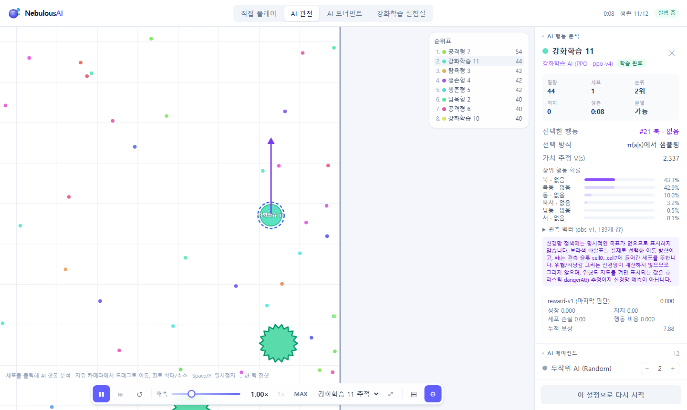
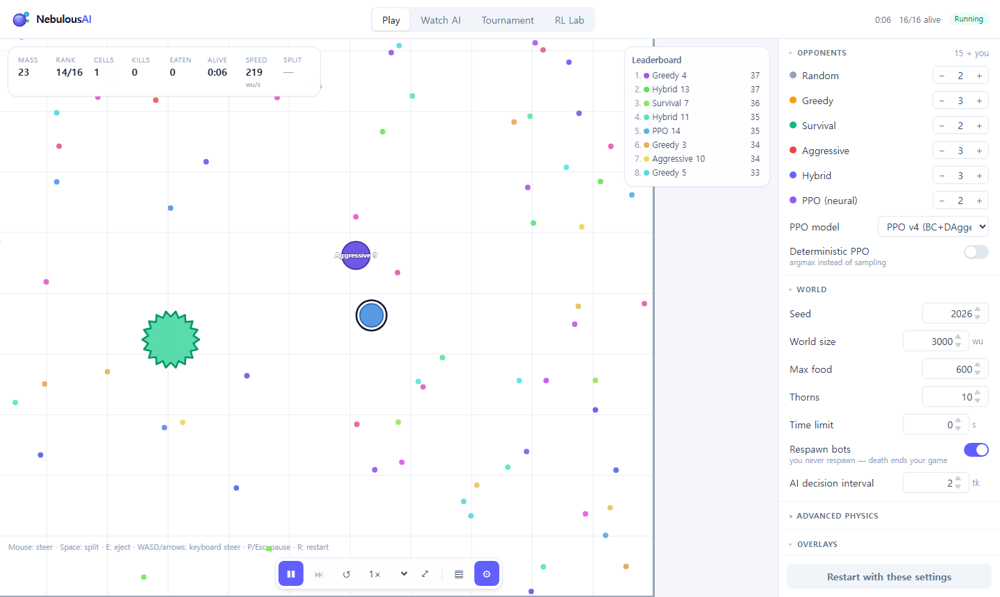
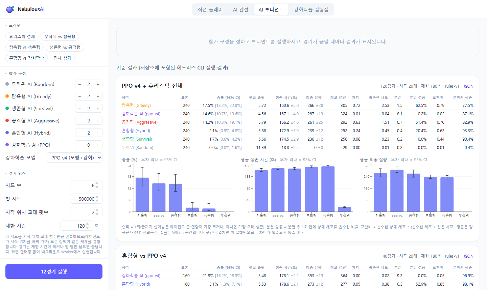
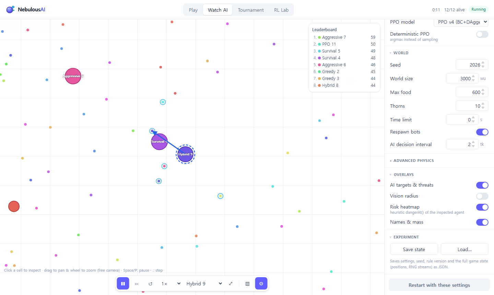
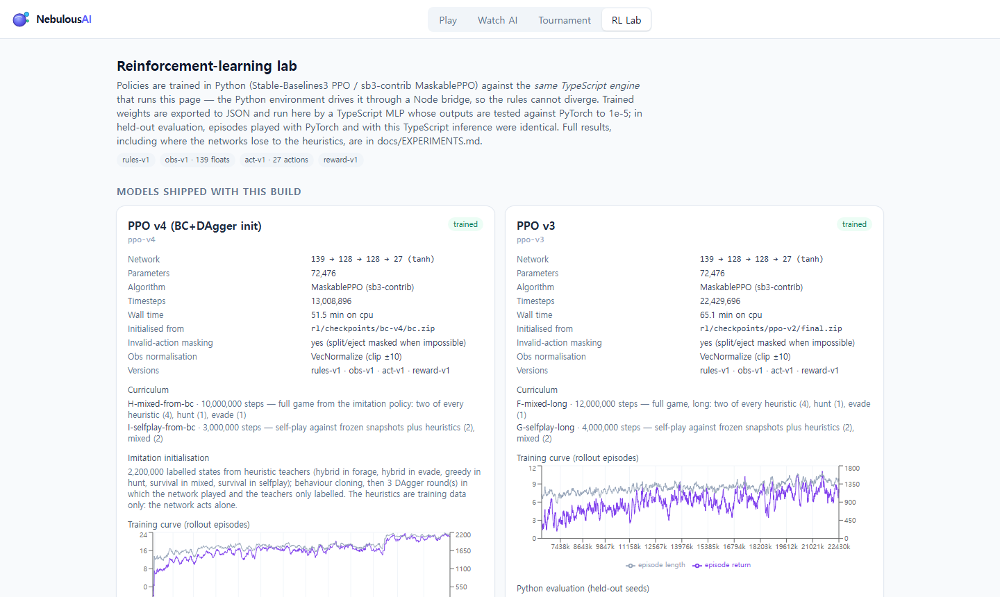

# NebulousAI

**세포형 생존 게임을 직접 플레이하고, 휴리스틱·강화학습 AI의 생존 전략과 다중 에이전트 경쟁을 실험하는 인터랙티브 AI 연구실**

*An interactive lab where you play a cell-survival game yourself and study how heuristic and
reinforcement-learning agents survive and compete in a multi-agent arena.*

**Live demo: https://oyueo-mm.github.io/NebulousAI/**

The entry page is now a quiet, white home screen with an independent cell simulation and quick links
to Play and Watch. Use the collapsible left sidebar to switch pages; phones and tablets use a menu
drawer with keyboard focus management. The Cherry × Pistachio palette is shared across the app.
Routes are `#/home`, `#/play`, `#/watch`, `#/tournament`, and `#/lab`; original `#play`-style links
still work. The home animation respects reduced motion and pauses when hidden. Game rules, AI models,
controls, and the experiment JSON format are unchanged.

NebulousAI is inspired by the cell-survival genre (Agar.io, Nebulous.io). It is an independent project
with its own rules, code and graphics; it is not affiliated with or endorsed by any commercial game,
uses none of their code or assets, and never connects to a game server.



## What you can do

| Mode | |
|---|---|
| **직접 플레이 (Play)** | Steer a cell with the mouse (or WASD / arrow keys, or an on-screen joystick on touch screens), eat food, swallow smaller cells, split (Space) to attack or escape, eject mass (E). Fifteen AI opponents, including the trained network. A first-visit guide and a **조작법** (controls) sheet explain everything; the HUD shows whether split and eject are available and, when you try anyway, says why not. |
| **AI 관전 (Watch AI)** | Choose how many of each AI play, follow any agent, pause / step one tick, drag a **log-scale speed slider (0.25× – 50×)** or use **최대 속도** (Max), and open **AI 행동 분석** (the inspector): what the agent sees, its mode, target, threats and risk (heuristics) — or its observation vector, action probabilities and value estimate (neural). Optional heuristic risk heatmap. |
| **Tournament** | Headless matches in a background worker over many seeds with spawn-position rotation; win rate with Wilson intervals, survival and mass with 95 % CIs; JSON / CSV export. Reference results from the CLI are shown alongside. |
| **RL Lab** | Every shipped network (trained and untrained) with its training curve, curriculum, imitation initialisation and held-out evaluation, plus the exact observation, action and reward definitions. |

Everything runs in the browser; there is no backend. The interface is in Korean; every visible string lives in
[`src/i18n/ko.ts`](src/i18n/ko.ts) (one typed dictionary, so another language is a second file of the same shape).
Model IDs, JSON keys and saved-file schemas are technical identifiers and stay untranslated.

**Controls**: PC: mouse to steer, WASD / arrow keys, Space split, E eject, P / Esc pause, R restart. Phone: joystick
(bottom left), 분열 / 방출 buttons (bottom right), pause in the dock; the speed chip opens a large slider sheet.
**Speed** changes only how many fixed simulation ticks run per real second; the physics, AI and results are identical
at every speed (tested). When a device cannot reach the target, the achieved speed is shown instead of the target.

| | |
|---|---|
|  |  |
|  |  |

## Results in one paragraph

Pure PPO (three generations, up to 22 M steps) learned to forage and evade better than the
hand-written heuristics but stayed far behind them in the full game (death rate 0.50 – 0.71 vs
0.04 – 0.15). Behaviour cloning with DAgger from the heuristics reached heuristic level, and PPO
fine-tuning on top of it (**ppo-v4**, the default model) exceeded every heuristic in held-out
full-game evaluation: return 26.6 ± 1.3 vs 23.7 ± 1.5 for the best heuristic, final mass 308 vs 224,
death rate 0.02 vs 0.04 (48 held-out seeds, the same heuristic opponents as in training). In
12-agent free-for-alls it has the best average rank and mass, but its win rate is statistically tied
with Greedy and Aggressive. The pure-RL agents also discovered a rules loophole — staying split into
small cells so that mass decay never applies. Details, caveats and all tables:
[docs/EXPERIMENTS.md](docs/EXPERIMENTS.md).

## Implemented vs. planned

**Implemented and tested**: the deterministic engine (movement, food, predation with order-independent
contest resolution, split, merge, eject, thorns, decay, respawn, mass ledger); play and watch modes with
mouse, keyboard and touch controls; five heuristic AIs; the decision inspector and heuristic risk
heatmap; save / load of complete game states; browser and CLI tournaments; Gymnasium, Stable-Baselines3
and PettingZoo environments driven by the same engine; PPO and MaskablePPO training with curricula and
self-play; behaviour cloning + DAgger initialisation; held-out evaluation; export to the browser with a
TypeScript MLP verified against PyTorch; GitHub Actions CI and Pages deployment.

**Not done** (see [Roadmap](#roadmap)): simultaneous multi-learner training (the PettingZoo environment
exists and passes the API test, but no model was trained with it), rules-v2 fixing the decay
loophole, continuous action spaces, thorn feeding / shooting, testing on real touch hardware,
Safari and Firefox.

## Game rules (short)

`r = 4√m`; speed falls with mass (`230·(m/20)^-0.36`, floor 40 wu/s); a cell eats a different owner's
cell when it is ≥ 1.25× heavier and the prey's centre is 0.4 r_prey inside its edge; simultaneous
contests go to the largest predator, independent of object order. Split halves a cell (≥ 36 mass, up
to 16 cells, 0.5 s cooldown) and launches the half ≈ 160 wu forward; halves merge back after 9 – 25 s.
Eject fires 16 mass of which 12.8 survive as a pellet. Large cells (≥ 143) that cover a thorn burst into
up to 9 pieces; small cells can hide under thorns. Mass above 60 per cell decays 0.2 % per second.
Full specification: [docs/RULES.md](docs/RULES.md).

## AI

* **Random** — seeded random walk (lower bound).
* **Greedy** — flee if in danger, else chase the most valuable prey (naive split attacks), else food.
* **Survival** — scores 16 headings by predicted, pursuit-aware danger (walls and corners included)
  against food; never hunts; emergency split-escape.
* **Aggressive** — intercept planning with prey-motion prediction; split attacks only when the odds are
  good and no bystander could eat its halves.
* **Hybrid** — switches between survival, hunting and safe foraging.
* **PPO** — 139 → 128 → 128 → 27 MLP trained against the real engine and executed in the browser.
  The inspector shows its actual outputs; it never invents a "target".

Details, including the bugs found while measuring them: [docs/AI_ALGORITHMS.md](docs/AI_ALGORITHMS.md).

## Reinforcement learning

Python never re-implements the game: the Gymnasium / SB3 / PettingZoo environments drive the
TypeScript engine through a Node bridge, so training and the browser share the rules, the
observation encoder (`obs-v1`, 139 floats, vision-limited), the 27 discrete actions (`act-v1`) and the
reward (`reward-v1`). This is verified by a golden trajectory reproduced bit for bit by both sides, by
an independent Python rule checker, and by evaluation episodes that are identical whether the network
runs in PyTorch or in the TypeScript MLP. Setup:
[docs/REINFORCEMENT_LEARNING.md](docs/REINFORCEMENT_LEARNING.md).

```bash
npm ci && npm run build:node
pip install torch --index-url https://download.pytorch.org/whl/cpu && pip install -r rl/requirements.txt
python -m rl.train   --config rl/configs/smoke.json     # 20-second wiring check
python -m rl.train   --config rl/configs/ppo_v2.json    # pure (Maskable)PPO curriculum, ~30 min on 8 CPU threads
python -m rl.imitate --config rl/configs/bc_v4.json     # behaviour cloning + DAgger, ~10 min
python -m rl.train   --config rl/configs/ppo_v4.json    # PPO from the imitation policy, ~50 min
```

Export, evaluation and tournament commands: [docs/EXPERIMENTS.md#reproduce](docs/EXPERIMENTS.md#reproduce).

## Tech stack

React 19 · TypeScript · Vite · Tailwind CSS 4 · Canvas 2D · Web Workers · Recharts · Vitest ·
Playwright · Python 3.12 · PyTorch · NumPy · Gymnasium · Stable-Baselines3 / sb3-contrib · PettingZoo.

## Run locally

```bash
npm ci
npm run dev            # http://127.0.0.1:5173/NebulousAI/
npm run build && npm run preview
npm run tournament -- --preset heuristics --seeds 20
npm run benchmark
```

## Tests

```bash
npm test                                         # 78 tests: engine, AI, encodings, golden trajectory, inference equivalence, speed pacing, i18n coverage
npm run build:node && python -m pytest rl/tests  # TS↔Python equivalence, rule conformance, Gymnasium / SB3 / PettingZoo checkers
npm run build && npm run test:e2e                # Playwright: Korean UI, controls, speed slider, 6 viewports, mobile emulation
```

Coverage and what is *not* covered: [docs/TESTING.md](docs/TESTING.md).

## Performance

On an Intel Core Ultra 7 256V: the world step costs < 0.1 ms per tick up to 50 agents and 2 000 food;
headless simulation runs 46 – 187× real time without PPO agents and 19 – 46× with them; the browser
keeps 60 render FPS and full real-time speed with 50 agents (25 of them neural), holds a fixed 50× exactly in the
default watch lineup and reaches about 90× in Max mode there (the heavy 25-PPO lineup reaches about 16× and the UI
says so). Tables and method: [docs/BENCHMARK.md](docs/BENCHMARK.md).

## Documentation

[RULES](docs/RULES.md) · [ARCHITECTURE](docs/ARCHITECTURE.md) · [AI_ALGORITHMS](docs/AI_ALGORITHMS.md) ·
[REINFORCEMENT_LEARNING](docs/REINFORCEMENT_LEARNING.md) · [TESTING](docs/TESTING.md) ·
[BENCHMARK](docs/BENCHMARK.md) · [EXPERIMENTS](docs/EXPERIMENTS.md)

## Roadmap

* rules-v2: apply mass decay to an agent's total mass (closing the fragmentation loophole), retrain.
* Evaluation against held-out opponent types (not only held-out seeds).
* Multi-learner PPO through the PettingZoo environment; league training against past snapshots.
* Hybrid action space (continuous heading + discrete special); attention over a variable number of
  visible cells.
* Thorn feeding and shooting via ejected mass.
* Real-device touch testing; Safari and Firefox in CI.

## License and references

MIT — see [LICENSE](LICENSE).

* Schulman et al., *Proximal Policy Optimization Algorithms*, 2017.
* Huang & Ontañón, *A Closer Look at Invalid Action Masking in Policy Gradient Algorithms*, 2020.
* Ross, Gordon & Bagnell, *A Reduction of Imitation Learning and Structured Prediction to No-Regret
  Online Learning* (DAgger), 2011.
* Raffin et al., *Stable-Baselines3*, JMLR 2021; Terry et al., *PettingZoo*, NeurIPS 2021.

Genre inspiration only: Agar.io and Nebulous.io are trademarks of their respective owners.
